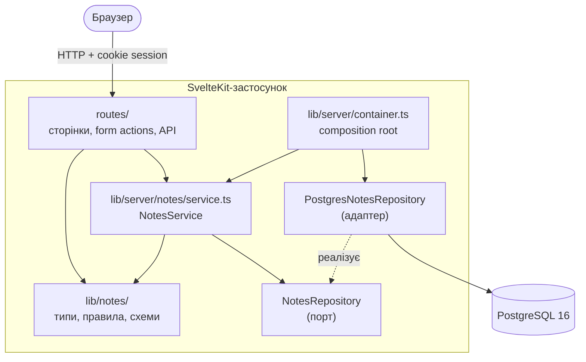

# Team Notes

Нотатки для невеликої команди: теги, фільтр, архівування, вхід за паролем.
Навчальний full-stack проєкт на SvelteKit 2 (Svelte 5), TypeScript, Tailwind CSS 4 і PostgreSQL 16.

[](https://github.com/<you>/team-notes/actions/workflows/ci.yml)

## Швидкий старт

Потрібно: Node.js 20+, Docker.

```bash
git clone https://github.com/<you>/team-notes.git
cd team-notes/app
cp .env.example .env
docker run -d --name team-notes-db -e POSTGRES_PASSWORD=devpass -p 5432:5432 postgres:16
docker exec team-notes-db createdb -U postgres team_notes
docker exec team-notes-db createdb -U postgres team_notes_test
npm ci
npm run db:migrate
npm run dev        # http://localhost:5173
```

## Скрипти (у `app/`)

| Скрипт | Що робить |
|---|---|
| `npm run dev` / `build` / `preview` | розробка, збірка, перегляд збірки |
| `npm run check` / `check:layers` | типи; напрям залежностей шарів |
| `npm run test:unit` / `test:integration` / `test:e2e` | тести (integration і e2e потребують тестову базу) |
| `npm run db:migrate` | застосувати міграції з `db/migrations/` |

## Архітектура

Модульний моноліт: один SvelteKit-застосунок і одна база.



- **Ядро** (`lib/notes`) не імпортує нічого з `lib/server` чи фреймворку — це перевіряє `npm run check:layers`.
- **Сервіс** отримує сховище через конструктор (DI). У unit-тестах — `InMemoryNotesRepository`, у застосунку — PostgreSQL.
- Рішення: [ADR 0001 — модульний моноліт](app/docs/adr/0001-modular-monolith.md). API: [docs/api.md](app/docs/api.md).

## Як зробити внесок

Гілка від `main` → малі коміти → PR за шаблоном → зелений CI → review → merge.
Див. [Definition of Done](app/docs/definition-of-done.md).
